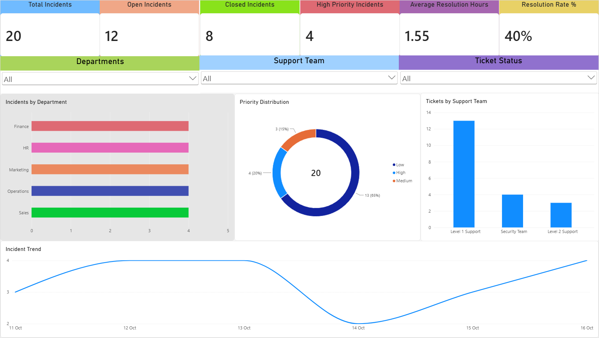

# IT-Service-Desk-Automation
A Python-based IT service desk solution designed to automate incident intake, ticket creation, assignment, prioritization, closure tracking, and performance reporting.

# IT Service Desk Automation & Analytics Platform



A Python based desk automation solution that automates incident creation, routing, prioritization, resolution tracking, and Power BI reporting.

## Overview

The IT Service Desk Automation & Analytics Platform is a Python based solution designed to simulate a real-world IT service desk environment. The project automates incident processing, ticket assignment, priority classification, incident closure tracking, and operational reporting through Power BI.

The solution demonstrates practical IT support, automation, reporting, and analytical skills commonly used by IT Support Analysts, Service Desk Analysts, and L2 IT Support professionals.

---

## Business Problem

Service desk teams often spend significant time performing repetitive administrative tasks such as:

- Creating incident records
- Assigning tickets to support teams
- Classifying priorities
- Tracking ticket status
- Measuring resolution performance

This project automates these processes to improve efficiency and reporting accuracy.

---

## Solution Architecture

```text
User Request
      ↓
Excel Incident Repository
      ↓
ticket_processor.py
      ↓
Priority Assignment
Support Team Routing
Ticket Creation
      ↓
Support Team Resolution
      ↓
ticket_closure.py
      ↓
Resolution Tracking
Performance Metrics
      ↓
Power BI Dashboard
```

---

## Features

### Automated Ticket Processing

- Generates unique Incident IDs
- Creates incident records automatically
- Assigns ticket ownership
- Sets incident priorities
- Tracks incident creation dates

### Intelligent Ticket Routing

| Issue Type | Assigned Team |
|------------|---------------|
| Forgotten Password | Level 1 Support |
| Password Expired | Level 1 Support |
| Account Locked | Level 1 Support |
| MFA Issue | Security Team |
| Other | Level 2 Support |

### Ticket Lifecycle Management

- New
- In Progress
- Pending User
- Resolved

### Incident State Management

- Open
- Closed

### Resolution Tracking

- Resolution notes
- Resolved date and time
- Resolution duration calculation

### Analytics Dashboard

- Total Incidents
- Open Incidents
- Closed Incidents
- Resolution Rate
- High Priority Incidents
- Average Resolution Time
- Department Analysis
- Support Team Workload
- Incident Trends

---

## Technology Stack

### Programming

- Python

### Python Libraries

- Pandas
- OpenPyXL

### Reporting & Analytics

- Microsoft Power BI

### Data Storage

- Microsoft Excel

### Data Collection

- Microsoft Forms (simulated intake process)

---

## Project Structure

```text
IT-Service-Desk-Automation
│
├── ticket_processor.py
├── ticket_closure.py
├── Requests.xlsx
├── Dashboard.pbix
├── Dashboard.png
├── requirements.txt
├── .gitignore
└── README.md
```

---

## Dashboard KPIs

The Power BI dashboard tracks key service desk performance indicators:

| KPI | Description |
|------|------------|
| Total Incidents | Total number of submitted incidents |
| Open Incidents | Incidents currently requiring action |
| Closed Incidents | Successfully resolved incidents |
| High Priority Incidents | Incidents requiring immediate attention |
| Average Resolution Hours | Mean incident resolution time |
| Resolution Rate | Percentage of incidents resolved |

---

## Sample Workflow

1. User submits an incident request.
2. Incident data is stored in the repository.
3. `ticket_processor.py` generates a unique incident ID.
4. Incident priority is assigned automatically.
5. Ticket is routed to the appropriate support team.
6. Support team resolves the issue.
7. Ticket is marked as **Resolved**.
8. `ticket_closure.py` records resolution details and calculates resolution time.
9. Power BI dashboard updates performance metrics.

---

## Skills Demonstrated

- IT Incident Management
- Service Desk Operations
- Process Automation
- Python Scripting
- Data Analysis
- Workflow Optimization
- KPI Reporting
- Power BI Dashboard Development
- Technical Documentation
- Troubleshooting and Support Operations

---

## Future Enhancements

- Microsoft Forms integration
- Email notifications
- SLA breach alerting
- Power Automate integration
- ServiceNow integration
- Historical reporting
- Automated technician assignment
- Power BI cloud publishing

---

## Author

**Kameshwaran Ramachandran**

IT Support Analyst | Service Desk Analyst | 
